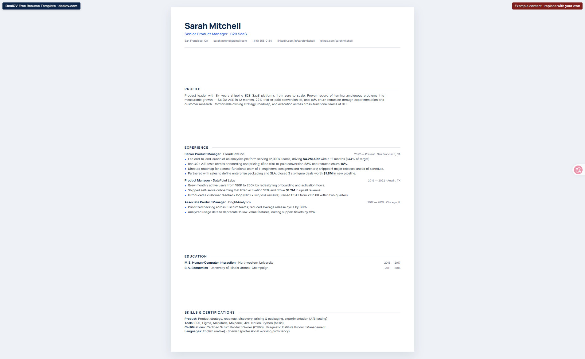
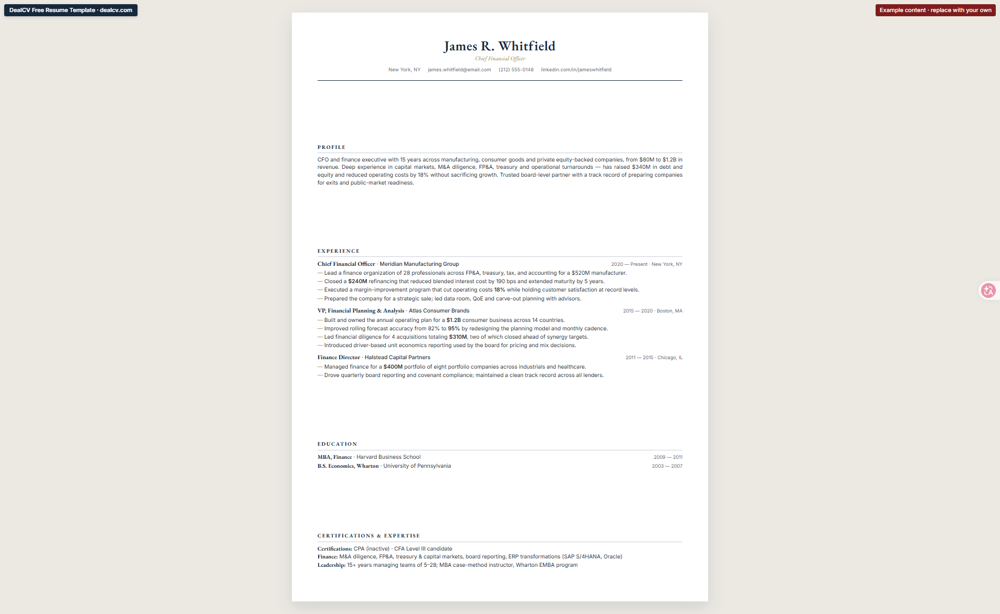
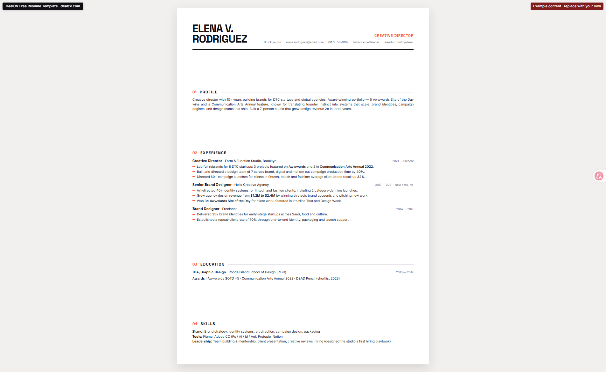
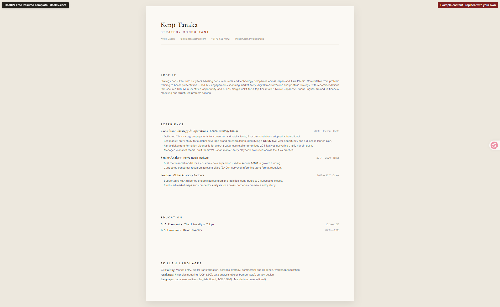
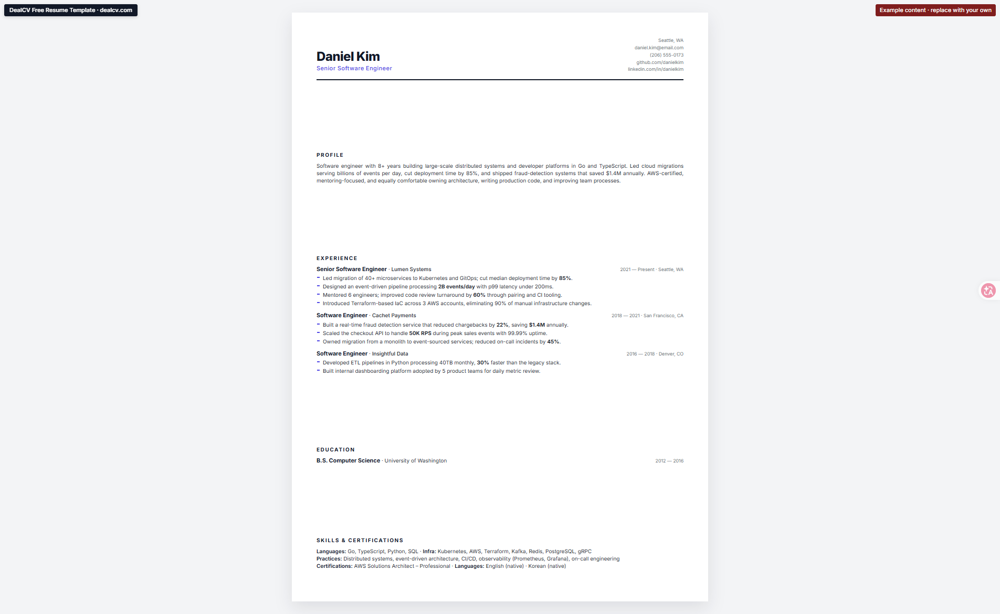
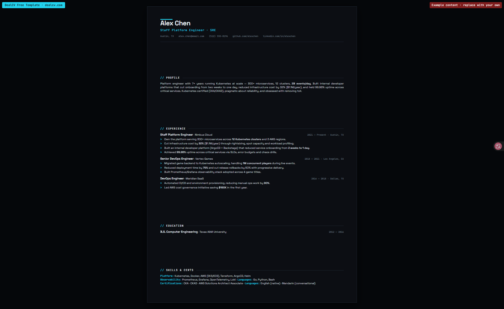

# DealCV Free Resume Templates

**Free, open-source resume templates by [DealCV](https://dealcv.com)** — single-file HTML, one A4 page, ATS-friendly, print-to-PDF from any browser. Zero dependencies, no install, no signup.

Six distinct designs with complete, quantified English sample content — download, open, replace the examples with your own details, and export.

## The 6 Free Templates

| File | Design | Preview |
| --- | --- | --- |
| `dealcv-resume-template.html` | **Skyline** — Minimal blue, clean SaaS-style (Product Manager) |  |
| `dealcv-resume-template-classic-business.html` | **Classic Executive** — Serif navy & gold (CFO) |  |
| `dealcv-resume-template-creative-bold.html` | **Statement** — Bold editorial magazine style (Creative Director) |  |
| `dealcv-resume-template-japanese-minimal.html` | **Paper** — Washi-paper minimalism (Strategy Consultant) |  |
| `dealcv-resume-template-modern-minimal.html` | **Modern** — Graphite & indigo (Software Engineer) |  |
| `dealcv-resume-template-tech-dark.html` | **Tech Dark** — Dark terminal style (Platform Engineer) |  |

All templates are single-file HTML with the same workflow: download → open in a browser → replace the example content → `Ctrl/Cmd + P` → save as PDF.

## Quick Start (30 seconds)

1. Download any `dealcv-resume-template-*.html`
2. Open it in Chrome / Edge / Firefox
3. Replace the sample content with your own information (name, role, experience, skills)
4. Export to PDF: `Ctrl/Cmd + P` → Destination: "Save as PDF" → Paper: A4, Margins: None → Save

> Each template carries a small DealCV badge in the top-left corner (linked to dealcv.com). It is automatically hidden when printing, so it never affects your printed resume.

## Template Features

- **Single file, zero dependencies** — all CSS is inline; no JS, no external stylesheet required; works offline
- **One-page A4 layout** — exact 210 × 297 mm page, density-tunable via the `--resume-density` CSS variable
- **Print-optimized** — `@page A4` plus forced print colors; the exported PDF matches the screen
- **ATS-friendly** — semantic HTML (`header` / `section` / `ul`) that parsers read cleanly
- **Easy theming** — every color lives in `:root` CSS variables; change a couple of lines to match your brand

## Customize Colors

Open the template and edit these variables inside `<style>` → `:root`:

```css
:root {
  --color-primary: #0B2447;   /* headings & main color */
  --color-accent:  #2563EB;   /* accent color */
  --color-muted:   #5C6773;   /* secondary text */
  --color-hairline:#D5DBE1;   /* divider lines */
}
```

Each template uses its own palette — the variable names are consistent across all six, so the same recipe works everywhere.

## Need a More Powerful Resume Tool?

DealCV's online builder adds AI keyword checking, ATS match optimization, and job-application automation:

👉 **https://dealcv.com**

## License

MIT License. These templates are forked from [Chasen-Liao/resume-skills](https://github.com/Chasen-Liao/resume-skills) (MIT).
The original author's copyright and license text are preserved in [LICENSE](LICENSE). Free to use, modify, commercialize, and redistribute.
